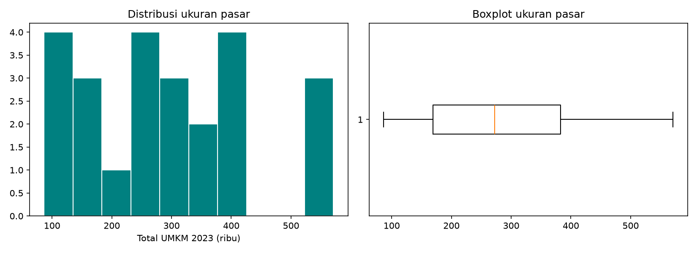
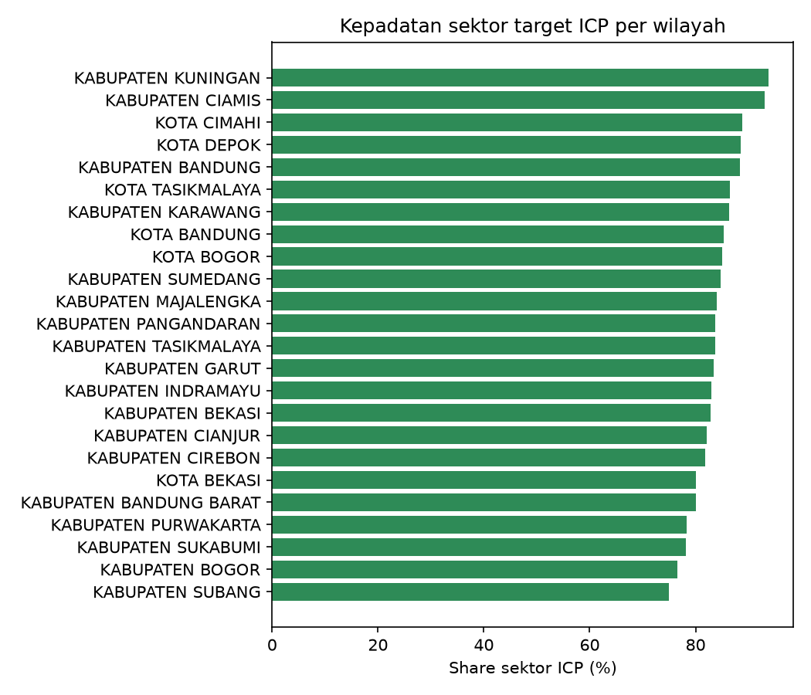
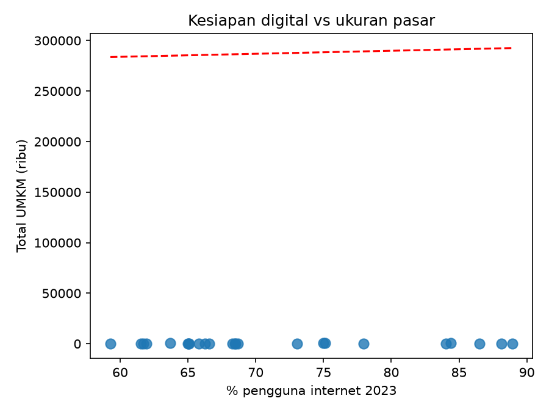
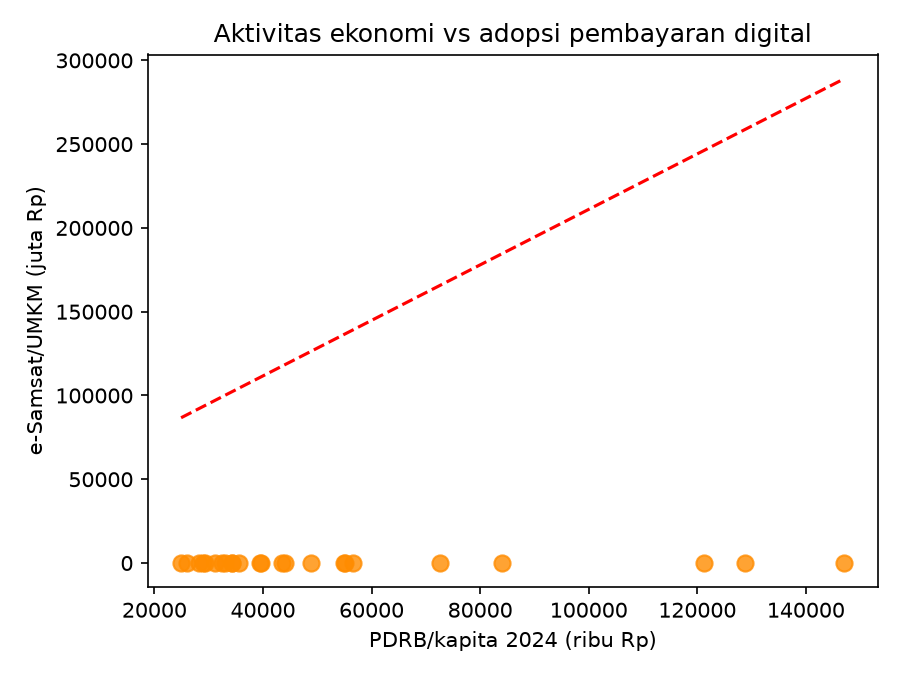
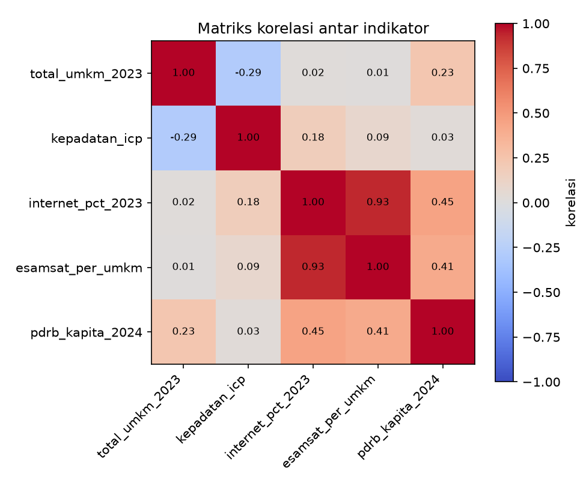

# Hasil — Tugas 2 Milestone 1 (Kelompok 2)

Halaman ini merangkum hasil notebook `Kelompok2_DS_SC_Public_VeteranTech_FINAL.ipynb`.
Pipeline-nya memproses 5 dataset publik atas 27 wilayah Jawa Barat, menyaringnya menjadi
24 wilayah lewat kriteria penggugur, menormalisasi 5 indikator ICP dengan Min-Max ke
rentang 0 sampai 1, lalu menyusun rancangan tabel bobot prioritas berbasis ICP Klay.

> Gambar di bawah dimuat dari folder `assets/` (hasil `plt.savefig` pada notebook).
> Pastikan kelima PNG sudah ada di folder tersebut sebelum di-push, yaitu dengan
> mengunduhnya dari folder `assets/` di Drive Colab.

## 1. Ringkasan pipeline

| Tahap | Hasil |
|---|---|
| Sumber data | 4 sumber resmi (ODJ-Diskuk, ODJ-Bapenda, ODJ-BPS, publikasi BPS), 5 dataset |
| Cleaning | 2 missing `kode_provinsi` diisi 32; 0 duplikat; kode wilayah e-Samsat disamaratakan dari 29 menjadi 27 |
| Merging | 27 wilayah × 8 kolom, tanpa missing |
| Kriteria penggugur | batas persentil ke-10 = 76.475 unit; 3 kota tereliminasi (Sukabumi, Cirebon, Banjar) |
| Normalisasi | Min-Max 0–1 atas 24 wilayah × 5 indikator |
| Tabel bobot | 5 komponen, total 100% |

## 2. EDA — 5 Visualisasi

### G1 — Distribusi ukuran pasar (univariat)

Sebaran total UMKM antar 24 wilayah condong ke kanan (skewness 0,45). Tiga wilayah
teratas adalah Kabupaten Bogor (571.944), Kabupaten Bandung (537.801), dan Kota Bandung
(523.584), yang menyendiri di atas 500 ribu unit. Artinya, volume calon leads terpusat
pada segelintir wilayah. Pengecekan IQR tidak menemukan outlier, sehingga konsentrasi
tersebut memang merupakan karakteristik pasar dan bukan kesalahan data.

### G2 — Kepadatan sektor target ICP (univariat)

Seluruh wilayah berada di atas 74%, dengan nilai terendah di Kabupaten Subang (74,9%)
dan tertinggi di Kabupaten Kuningan (93,8%). Segmen usaha bertipe transaksi harian
rutin (ritel, F&B, jasa) ternyata dominan di semua wilayah, sehingga pembedanya hanya
proporsinya. Perlu dicatat bahwa nilai 2023 dihitung tanpa kontribusi F&B akibat
anomali pencatatan, sehingga angka ini cenderung underestimate untuk wilayah dengan
basis kuliner yang kuat.

### G3 — Kesiapan digital vs ukuran pasar (bivariat)

Korelasinya hampir nol (r = 0,02): wilayah dengan penetrasi internet tinggi tidak
otomatis memiliki banyak UMKM. Kabupaten dengan pasar sangat besar justru berada pada
penetrasi internet menengah, sedangkan kota kecil unggul secara digital tetapi kecil
pasarnya. Kesiapan digital dan ukuran pasar dengan demikian mengukur hal yang berbeda,
sehingga keduanya memang layak menjadi komponen terpisah dalam skor prioritas.

### G4 — Aktivitas ekonomi vs adopsi pembayaran digital (bivariat)

Korelasi moderat positif (r = 0,41): masyarakat berdaya beli tinggi cenderung lebih
banyak bertransaksi non-tunai melalui e-Samsat, dengan Kota Depok dan Kota Bekasi
sebagai wilayah adopsi tertinggi per UMKM. Sebarannya sendiri cukup luas, sehingga
daya beli mendorong perilaku digital tetapi ada faktor lain yang turut bekerja.

### G5 — Matriks korelasi antar indikator (multivariat)

Dua temuan. Pertama, korelasi internet dan e-Samsat per UMKM sangat tinggi (r = 0,93),
yang berarti proksi e-Samsat sebagian besar menangkap kesiapan digital wilayah, bukan
murni perilaku UMKM; bobot kedua komponen ini (20% + 15%) sebagian menghitung hal yang
serupa, dan hal itu dicatat sebagai keterbatasan sekaligus bahan uji sensitivitas pada
Final Project. Kedua, tidak ada korelasi lain di atas 0,45, dan kepadatan sektor justru
sedikit berbanding terbalik dengan ukuran pasar (r = −0,29), sehingga prioritas tidak
dapat ditentukan hanya dari ukuran wilayah.

## 3. Kriteria penggugur — hasil

| Wilayah | Total UMKM 2023 | Alasan |
|---|---|---|
| Kota Sukabumi | 60.866 | di bawah batas persentil ke-10 (76.475 unit) |
| Kota Cirebon | 61.234 | di bawah batas persentil ke-10 (76.475 unit) |
| Kota Banjar | 39.422 | di bawah batas persentil ke-10 (76.475 unit) |

Kriteria "data kunci kosong" tidak mengenai wilayah mana pun. Kriteria "sektor tanpa
transaksi harian rutin" sudah ditangani sejak tahap pemetaan sektor, yaitu hanya ritel,
F&B, dan jasa yang dihitung.

## 4. Tabel bobot indeks prioritas (berbasis ICP Klay)

| Komponen | Indikator Publik | Arah | Bobot | Justifikasi Bisnis |
|---|---|---|---|---|
| Ukuran Pasar | Total UMKM 2023 | + | 30% | Volume leads terbesar; pipeline SDR bergantung pada jumlah calon klien |
| Kepadatan Sektor Target | Share ritel + F&B + jasa (binaan 2023) | + | 25% | Klay ditujukan bagi usaha dengan transaksi harian rutin |
| Kesiapan Digital | % penduduk 5+ pengguna internet 2023 | + | 20% | Klay berbasis awan, sehingga kesiapan digital menjadi prasyarat pemanfaatan produk |
| Adopsi Pembayaran Digital | e-Samsat 2024 per UMKM (proksi) | + | 15% | Proksi perilaku non-tunai, karena data transaksi QRIS UMKM tidak tersedia untuk publik |
| Aktivitas Ekonomi | PDRB per kapita 2024 (ADHB) | + | 10% | Daya beli menunjang kemampuan berlangganan, dengan peran di bawah empat komponen lain |
| **Total** | | | **100%** | |

Indeks skor akhir, K-Means, uji sensitivitas, dan Top 5 segmen dikerjakan pada tahap
Final Project, di luar cakupan Milestone 1.
